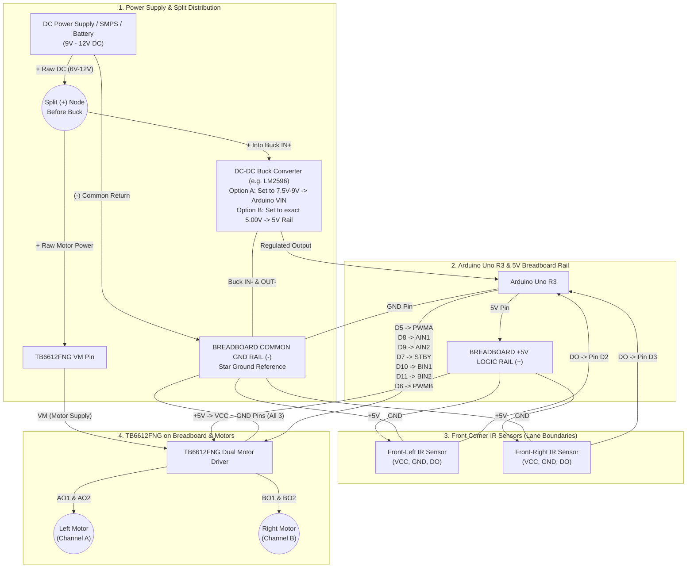

# LFR V1.1.01 — Wiring Diagram, Power Distribution & Ground Verification

**Target Version:** `LFR_V1.1.01` / `LFR_V1.1.02` (Dual Boundary-Line Keeping Test)  
**Hardware:** Arduino Uno R3 + TB6612FNG (on Breadboard) + 2x DC Motors + 2x IR Sensors + Adapter / SMPS & Buck Converter

---

## 1. System Power & Signal Architecture



---

## 2. Detailed ASCII Schematic (Breadboard + Power Split + Common GND)

```text
====================================================================================================
                         POWER SUPPLY & SPLIT BEFORE BUCK CONVERTER
====================================================================================================

  [ DC ADAPTER / SMPS / BATTERY ]  (9V - 12V DC Recommended; TB6612FNG VM max is 13.5V)
       |              |
      (+)            (-)
       |              |
       +---[SPLIT]    +---------------------------------------+
       |      |                                               |
       |      | (Branch 1: Raw Motor Voltage 9V-12V)          |
       |      +--------------------------------------------+  |
       |                                                   |  |
       | (Branch 2: To Buck Converter Input)               |  |
       v                                                   |  |
  +---------+------------+                                 |  |
  |   IN+        IN-     |                                 |  |
  |  [ BUCK CONVERTER ]  |  <-- IMPORTANT: Verify voltage  |  |
  |  OUT+       OUT-     |      & polarity with multimeter |  |
  +---+----------+-------+      BEFORE connecting Arduino! |  |
      |          |                                         |  |
      |          +-----------------------------------------|--+ (Buck IN- & OUT- are common)
      |                                                    |  |
      |  * Choose ONE Buck Output Setup:                   |  |
      |    - Setup A (Safer): Set Buck to 7.5V-9V -------->|->|---> Arduino [VIN] (or Barrel Jack)
      |      (Arduino onboard reg makes +5V on [5V])       |  |
      |    - Setup B (Direct): Set Buck to EXACT 5.00V --->|->|---> Breadboard [+5V RAIL] & Arduino [5V]
      v                                                    |  |
===========================================================|==|=====================================
  BREADBOARD POWER RAILS                                   |  |
===========================================================|==|=====================================
                                                           |  |
  (+) +5V LOGIC RAIL  =====================================|==|====+=======+=======+=======+
      (Fed from Arduino [5V] pin in Setup A,               |  |    |       |       |       |
       or from 5.00V Buck OUT+ in Setup B)                 |  |    |       |       |       |
                                                           |  |    |       |       |       |
  (-) COMMON GND RAIL =====================================|--+====|===+===|===+===|===+===|===+
      (Adapter -, Buck IN-/OUT-, Arduino GND,              |       |   |   |   |   |   |   |   |
       TB6612FNG GNDs, Left/Right IR Sensor GNDs)          |       |   |   |   |   |   |   |   |
                                                           |       |   |   |   |   |   |   |   |
===========================================================|=======|===|===|===|===|===|===|===|
  BREADBOARD CENTER (TB6612FNG Straddling Center Trench)   |       |   |   |   |   |   |   |   |
===========================================================|=======|===|===|===|===|===|===|===|
                                                           |       |   |   |   |   |   |   |   |
                     +--------------------+                |       |   |   |   |   |   |   |   |
      Raw 9-12V ---->| VM            PWMA |<--- Arduino D5 |       |   |   |   |   |   |   |   |
      +5V Rail  ---->| VCC           AIN2 |<--- Arduino D9 |       |   |   |   |   |   |   |   |
      Common GND --->| GND           AIN1 |<--- Arduino D8 |       |   |   |   |   |   |   |   |
   [LEFT MOTOR +] <--| AO1           STBY |<--- Arduino D7 |       |   |   |   |   |   |   |   |
   [LEFT MOTOR -] <--| AO2           BIN1 |<--- Arduino D10|       |   |   |   |   |   |   |   |
  [RIGHT MOTOR -] <--| BO2           BIN2 |<--- Arduino D11|       |   |   |   |   |   |   |   |
  [RIGHT MOTOR +] <--| BO1           PWMB |<--- Arduino D6 |       |   |   |   |   |   |   |   |
      Common GND --->| GND            GND |<---------------+-------+   |   |   |   |   |   |   |
                     +--------------------+                            |   |   |   |   |   |   |
                       TB6612FNG Breakout                              |   |   |   |   |   |   |
                                                                       |   |   |   |   |   |   |
=======================================================================|===|===|===|===|===|===|
  ARDUINO UNO R3 & FRONT IR SENSORS                                    |   |   |   |   |   |   |
=======================================================================|===|===|===|===|===|===|
                                                                       |   |   |   |   |   |   |
  [ ARDUINO UNO R3 ]                                                   |   |   |   |   |   |   |
- Pin [5V]  -----------------------------------------------------------+   |   |   |   |   |   |
- Pin [GND] ---------------------------------------------------------------+   |   |   |   |   |
- Pin [D2]  <---- [DO]   FRONT-LEFT IR SENSOR   [VCC] <------------------------+   |   |   |   |
                                                [GND] <----------------------------+   |   |   |
- Pin [D3]  <---- [DO]   FRONT-RIGHT IR SENSOR  [VCC] <--------------------------------+   |   |
                                                [GND] <------------------------------------+   |
                                                                                               |
===============================================================================================+
```

---

## 3. Complete Pin-by-Pin Connection Tables

### A. Power & Ground Connections

| Source | Destination | Voltage Level | Notes / Protection Rule |
| :--- | :--- | :--- | :--- |
| **Adapter / SMPS `(+)`** | Split Node -> **TB6612FNG `VM`** & **Buck `IN+`** | `6V – 12V DC` | **Max `13.5V`** for TB6612FNG `VM`. |
| **Adapter / SMPS `(-)`** | **Breadboard Common `GND` Rail** & **Buck `IN-`** | `0V (GND)` | Primary return path for motor current. |
| **Buck `OUT-`** | **Breadboard Common `GND` Rail** | `0V (GND)` | Keeps logic and motor grounds referenced together. |
| **Buck `OUT+` (Setup A — Recommended)** | **Arduino `VIN`** (or Barrel Jack) | **`7.5V – 9.0V DC`** | Uses Arduino's onboard regulator; Arduino **`5V` pin** then supplies the Breadboard `+5V Rail`. |
| **Buck `OUT+` (Setup B — Direct 5V)** | **Breadboard `+5V Rail`** & **Arduino `5V`** | **`5.00V DC` Exact** | **Measure with multimeter BEFORE connecting!** Exceeding `5.5V` or reversing polarity on `5V` destroys the MCU. |
| **Arduino `GND`** | **Breadboard Common `GND` Rail** | `0V (GND)` | **Mandatory:** Without common GND between Arduino and TB6612FNG, PWM/direction logic signals float and motors act erratically. |

---

### B. TB6612FNG Dual Motor Driver (On Breadboard)

| TB6612FNG Pin | Connects To | Function |
| :--- | :--- | :--- |
| **`VM`** | **Adapter `(+)` Split** (Before Buck Converter) | Raw Motor Power Supply (`6V–12V DC`) |
| **`VCC`** | **Breadboard `+5V` Logic Rail** | IC Logic Power Supply (`5.0V DC`) |
| **`GND`** (all 3 pins) | **Breadboard Common `GND` Rail** | Tie both logic-side and motor-side `GND` pins to Common `GND` |
| **`STBY`** | **Arduino Pin `D7`** | Driver Enable (`HIGH` = Active, `LOW` = Standby) |
| **`PWMA`** | **Arduino Pin `D5` (PWM~)** | Left Motor (Channel A) Speed (`0–255`) |
| **`AIN1`** | **Arduino Pin `D8`** | Left Motor Direction Input 1 (`HIGH` = Forward) |
| **`AIN2`** | **Arduino Pin `D9`** | Left Motor Direction Input 2 (`LOW` = Forward) |
| **`AO1`, `AO2`** | **Left DC Motor Terminals** | Swap `AO1`/`AO2` wires if Left Motor spins backward on `forward()` |
| **`PWMB`** | **Arduino Pin `D6` (PWM~)** | Right Motor (Channel B) Speed (`0–255`) |
| **`BIN1`** | **Arduino Pin `D10`** | Right Motor Direction Input 1 (`HIGH` = Forward) |
| **`BIN2`** | **Arduino Pin `D11`** | Right Motor Direction Input 2 (`LOW` = Forward) |
| **`BO1`, `BO2`** | **Right DC Motor Terminals** | Swap `BO1`/`BO2` wires if Right Motor spins backward on `forward()` |

---

### C. Dual Hobbyist IR Sensors (Front Left & Front Right)

| Sensor Module | Sensor Pin | Connects To | Notes |
| :--- | :--- | :--- | :--- |
| **Front-Left IR Sensor** | `VCC` | **Breadboard `+5V` Rail** | 5V logic power |
| **Front-Left IR Sensor** | `GND` | **Breadboard Common `GND` Rail** | Common ground |
| **Front-Left IR Sensor** | `DO` (or `OUT`) | **Arduino Pin `D2`** | Digital output (`HIGH` on black line, `LOW` on white floor) |
| **Front-Right IR Sensor** | `VCC` | **Breadboard `+5V` Rail** | 5V logic power |
| **Front-Right IR Sensor** | `GND` | **Breadboard Common `GND` Rail** | Common ground |
| **Front-Right IR Sensor** | `DO` (or `OUT`) | **Arduino Pin `D3`** | Digital output (`HIGH` on black line, `LOW` on white floor) |

---

## 4. Pre-Power-On Ground & Polarity Verification Checklist

Before plugging the power supply into the Arduino or turning on the adapter/SMPS:

1. **Disconnect the Arduino Uno** from the breadboard `+5V`/`VIN` wire.
2. **Power on only the Adapter/SMPS + Buck Converter** and measure with a multimeter (DC Voltage mode):
   - Black probe on **Breadboard Common `GND` Rail**, Red probe on **TB6612FNG `VM` row** -> Should read **+Adapter Voltage** (e.g. `+9.0V` to `+12.0V`, positive sign).
   - Black probe on **Breadboard Common `GND` Rail**, Red probe on **Buck `OUT+`** -> Should read **`+7.5V to +9.0V`** (if going to Arduino `VIN`) or **`+5.00V`** (if going to the `5V` rail). **Verify there is NO minus (`-`) sign on the multimeter.**
3. **Power OFF the Adapter/SMPS** and switch the multimeter to **Continuity / Resistance (`Ω`) mode**:
   - Verify continuity (`< 0.5 Ω` / beep) between all 5 ground points:
     1. Adapter / SMPS `(-)`
     2. Buck Converter `OUT-`
     3. Arduino Uno `GND` pin (or metal USB shell)
     4. TB6612FNG `GND` pins
     5. Left & Right IR Sensor `GND` pins
   - Verify there is **NO short circuit** (`OL` / `> 1 kΩ`) between the **Breadboard `+5V` Rail** and **Common `GND` Rail**, or between **`VM`** and **`+5V`**.
